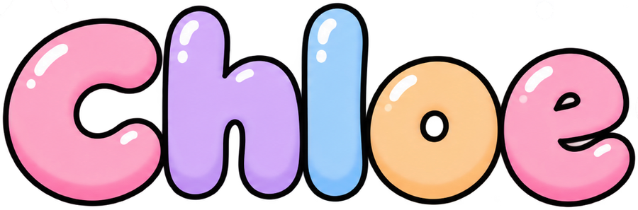

hi, i'm chloe. i'm from california. i like building whatever just whenever :0

currently working on **openlet**, **kiri** and **launchdx**.

## things i've made 

-  **[openlet](https://github.com/ChloeVPin/Openlet)** · `TypeScript` · open-source flashcards with FSRS spaced repetition, study modes, collaborative classes
-  **[kiri](https://github.com/ChloeVPin/Kiri)** · `Rust` · native desktop app runtime for linux, macOS and windows. webview-based, 3.7x smaller than tauri
-  **[launchdx](https://github.com/ChloeVPin/Launchdx)** · `Swift` · find out exactly why macOS blocked your app: code signing, notarization, gatekeeper, quarantine
-  **[deletely](https://deletelymac.vercel.app)** · `Swift` · maps the forward delete key to actually deleting files in finder. 13 MB, 12 MB RAM, 0% CPU
-  **[caffeinate](https://caffeinatemac.vercel.app)** · `Swift` · menu bar app that drives `/usr/bin/caffeinate` with 1, 2 and 4 hour timers. no dependencies

## also building 

[openpoll](https://github.com/ChloeVPin/Openpoll) · [clorion](https://github.com/ChloeVPin/Clorion) · [quiet](https://github.com/ChloeVPin/Quiet) · [tempo](https://github.com/ChloeVPin/Tempo) · [swapdex](https://github.com/ChloeVPin/Swapdex) · [musicport](https://github.com/ChloeVPin/Musicport) · [open-agent-skills](https://github.com/ChloeVPin/Open-agent-skills)

## how i build 

i'd rather show you the evidence than ask you to trust me.

## say hi 

[website](https://chloevalesquez.vercel.app) · [x](https://x.com/chloevalesquez) · [email](mailto:chloevalesquez@gmail.com) · [discord](https://discord.com/servers/chloe-s-coding-clubhouse-1418626982861733911)

the rest is in the [repository list](https://github.com/ChloeVPin?tab=repositories) 

