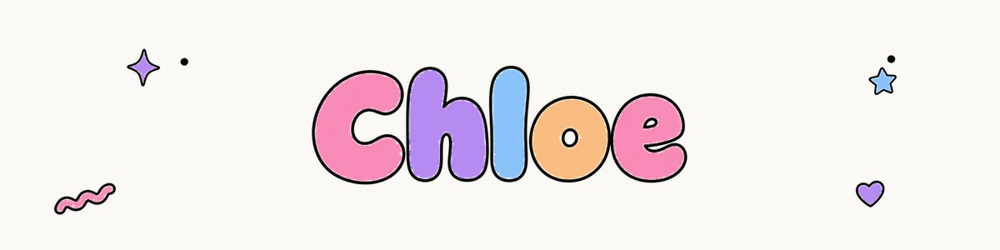

<picture>
  <source media="(prefers-color-scheme: dark)" srcset="./assets/banner-dark.jpg">
  
</picture>

hi, i'm chloe. i'm a developer in california. i like cute design, clean code,
and finishing what i start.

most of what i make is small, local-first and quietly useful — no accounts, no
ads, no telemetry. lately i've been working on **openlet**, **kiri** and
**launchdx**.

<picture><source media="(prefers-color-scheme: dark)" srcset="./assets/decor/squiggle-dark.png"></picture>

## things i've made <picture><source media="(prefers-color-scheme: dark)" srcset="./assets/decor/star5-dark.png"></picture>

-  **[openlet](https://github.com/ChloeVPin/Openlet)** — `TypeScript` — open-source flashcards with FSRS spaced repetition, study modes, collaborative classes
-  **[kiri](https://github.com/ChloeVPin/Kiri)** — `Rust` — native desktop app runtime for linux, macOS and windows. webview-based, 3.7x smaller than tauri
-  **[launchdx](https://github.com/ChloeVPin/Launchdx)** — `Swift` — find out exactly why macOS blocked your app: code signing, notarization, gatekeeper, quarantine
-  **[deletely](https://deletelymac.vercel.app)** — `Swift` — maps the forward delete key to actually deleting files in finder. 13 MB, 12 MB RAM, 0% CPU
-  **[caffeinate](https://caffeinatemac.vercel.app)** — `Swift` — menu bar app that drives `/usr/bin/caffeinate` with 1, 2 and 4 hour timers. no dependencies

## also building <picture><source media="(prefers-color-scheme: dark)" srcset="./assets/decor/flower-dark.png"></picture>

[openpoll](https://github.com/ChloeVPin/Openpoll) · [clorion](https://github.com/ChloeVPin/Clorion) · [quiet](https://github.com/ChloeVPin/Quiet) · [tempo](https://github.com/ChloeVPin/Tempo) · [swapdex](https://github.com/ChloeVPin/Swapdex) · [musicport](https://github.com/ChloeVPin/Musicport) · [open-agent-skills](https://github.com/ChloeVPin/Open-agent-skills)

## how i build <picture><source media="(prefers-color-scheme: dark)" srcset="./assets/decor/cross-dark.png"></picture>

**local-first**, **evidence-first**, and **no tracking** — no accounts, no ads, no telemetry.

## say hi <picture><source media="(prefers-color-scheme: dark)" srcset="./assets/decor/heart-dark.png"></picture>

[website](https://chloevalesquez.vercel.app) · [x](https://x.com/chloevalesquez) · [email](mailto:chloevalesquez@gmail.com) · [discord](https://discord.com/servers/chloe-s-coding-clubhouse-1418626982861733911)

the rest is in the [repository list](https://github.com/ChloeVPin?tab=repositories) <picture><source media="(prefers-color-scheme: dark)" srcset="./assets/decor/eraser-dark.png"></picture>

<picture>
  <source media="(prefers-color-scheme: dark)" srcset="./assets/footer-dark.jpg">
  
</picture>
